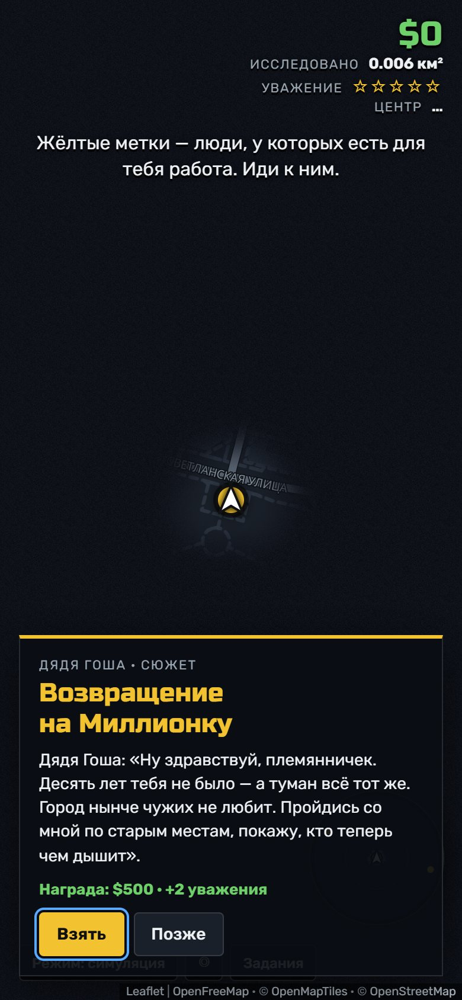
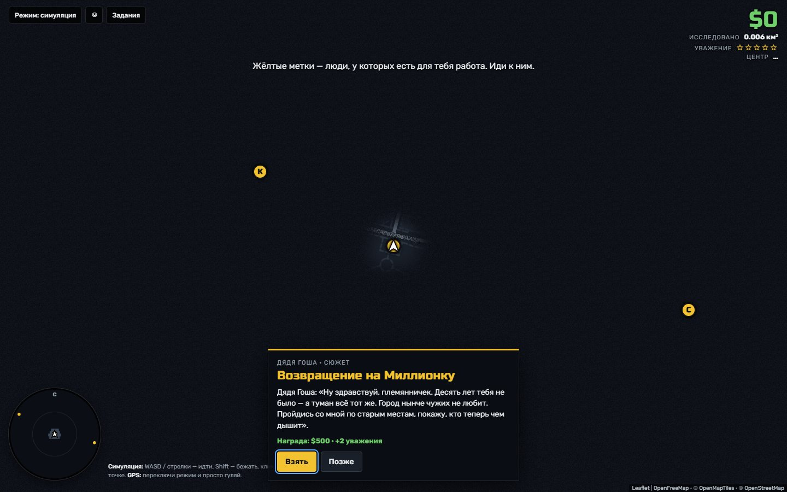

<div align="center">

# Туман Владивостока

**Уличная игра на реальной карте: город скрыт туманом и открывается там, где ты прошёл ногами.**

    

<a href="https://limmmp.github.io/vl-fog/"></a>

</div>

<table>
<tr>
<td align="center" valign="top"></td>
<td align="center" valign="top"></td>
</tr>
</table>

> Мобильная версия на Flutter с фоновым GPS: [vl-fog-mobile](https://github.com/Limmmp/vl-fog-mobile)

<!-- header:end -->
Уличная игра на реальной карте города: как в GTA, карта скрыта туманом и открывается там, где ты прошёл ногами. По городу разбросаны жёлтые метки, за которыми стоят заказчики с заданиями. Задания генерируются из реальных мест вокруг тебя: кафе, парков, причалов, памятников.

## Запуск

Нужен Node.js 18+ (или Python).

```bash
npm start            # → http://localhost:3000
# или
python3 -m http.server 3000
```

Открывать `index.html` двойным кликом нельзя: ES-модули и GPS работают только через http(s).

## Управление

| | |
|---|---|
| WASD / стрелки | идти (в симуляции время ускорено ×8) |
| Shift | бежать |
| Клик по карте | идти к точке |
| «Режим» | переключение симуляция ↔ GPS |
| J / «Задания» | журнал, районы и настройки |
| Клик по радару | центрировать карту на игроке |

## Как играть с телефона на улице

GPS в браузере работает только по **https**. Варианты:

1. **GitHub Pages**: залей папку в репозиторий, включи Pages и открой ссылку с телефона. Это самый простой путь.
2. **Туннель с компьютера**: `npx localtunnel --port 3000` или `cloudflared tunnel --url http://localhost:3000`.

## Установка на телефон

Игра — PWA: открой её по https и выбери «Установить» (кнопка появится в верхней панели) или «На экран Домой» в Safari. Перед прогулкой можно открыть «Задания» → «Сохранить карту в радиусе 1 км», тогда карта будет видна и без связи.

## Районы

Город разбит на микрорайоны (Центр, Эгершельд, Первая Речка, Чуркин и другие). Процент района — доля его улиц, по которым ты прошёл. За 25, 50, 75 и 90 % дают деньги и уважение.

## Локальная модель для сюжетов

1. Установи [Ollama](https://ollama.com) и скачай модель: `ollama pull qwen2.5:7b`. Она неплохо пишет по-русски и держит JSON.
2. Разреши браузеру к ней обращаться: `OLLAMA_ORIGINS="*" ollama serve`.
3. В игре открой «Задания» → «Генератор сюжетов» → «Локальная модель».

Если модель не ответила или вернула ерунду, игра молча вернётся к встроенному генератору.

## Структура

```
index.html
css/style.css
js/
  main.js            — сборка: карта, слои, цикл, кнопки
  districts.js       — районы и % открытия их улиц
  radar.js           — радар и стрелка на цель у края экрана
  route.js           — пешеходные маршруты (OSRM), по ним ходят NPC
  offline.js         — PWA: установка, карта для офлайна, экран не гаснет
  basemap.js         — подложка OpenFreeMap и её офлайн-кэш
  geo.js             — расстояния, сетка тумана
  fog.js             — туман войны (данные + canvas-слой)
  player.js          — игрок: симуляция и GPS
  poi.js             — реальные места из OSM (Overpass) + достопримечательности
  ui.js              — HUD, субтитры, баннеры, карточки
  quests/
    schema.js        — формат квеста и его проверка (контракт для всех генераторов)
    engine.js        — движок: метки, шаги, награды
    templates.js     — шаблонные задания и персонажи
    story-vladivostok.js — сюжетная арка «Золотой туман»
    ollama.js        — генерация локальной моделью
vendor/leaflet/      — Leaflet 1.9.4
vendor/maplibre/     — MapLibre GL 5.24 + плагин для Leaflet (векторная подложка)
map/style.json       — стиль карты (пересобрать: python tools/build-map-style.py)
sw.js, manifest.webmanifest, icons/ — PWA
```

Карта © участники OpenStreetMap, тайлы — OpenFreeMap / © OpenMapTiles, отрисовка — MapLibre GL, маршруты — OSRM на сервере FOSSGIS.
